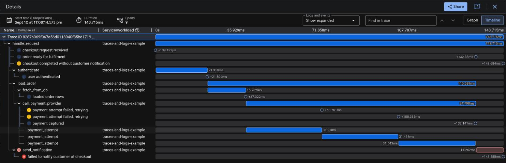

# Traces and logs together

The `traces-and-logs` examples run a request handler with a multi-level span tree and a log line at every level, one of them on a spawned task.
In the Google Cloud console, open a trace in Trace Explorer and its "Logs" panel lists each entry under the span that emitted it, or open an entry in Logs Explorer and follow its trace link back to the waterfall.



## With OTLP

Spans and log records go to the Telemetry API from one builder:

```rust,ignore
{{#include ../../../examples/traces_and_logs/otlp.rs:setup}}
```

```bash
PROJECT_ID=<your-google-project-id> cargo run --example traces-and-logs-otlp --features logs-otlp
```

## With the Cloud Trace API

Spans go to the Cloud Trace API and the entries to stdout, or to the Cloud Logging API:

```rust,ignore
{{#include ../../../examples/traces_and_logs/cloud_trace_api.rs:layers}}
```

```bash
PROJECT_ID=<your-google-project-id> cargo run --example traces-and-logs-cloud-trace-api --features trace-api,logs-api
```

The development mode of this example writes every event to the terminal and to the Cloud Logging API, so that a run from a laptop shows the correlated entries in the console. A service picks one sink.

## Global subscriber

Both examples install a global subscriber, not a scoped `with_default` one, because the workload carries a span across a `tokio::spawn` boundary with `Instrument`, onto a thread a thread-local subscriber is not set on.

The last console line of each example prints the trace ID together with direct links to Trace Explorer and Logs Explorer.

Full example available [here](https://github.com/abdolence/gcloud-observability-rs/blob/master/examples/traces_and_logs/otlp.rs).
